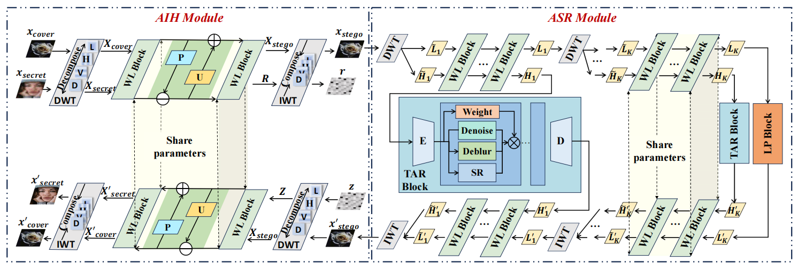

# AIRPNet: Adaptive Image Restoration with Privacy Protection in Steganographic Domain

[](https://ieeexplore.ieee.org/document/11419884/)
[](LICENSE)

<p align="center">
  
</p>

## 📖 Introduction

This is the official PyTorch implementation of the paper **"AIRPNet: Adaptive image restoration with privacy protection in steganographic domain"**, accepted by *IEEE Transactions on Pattern Analysis and Machine Intelligence (TPAMI)*, 2026.

In this work, we propose AIRPNet, a novel framework designed to achieve adaptive image restoration while ensuring robust privacy protection within the steganographic domain. 

## 🛠️ Environment Setup

This project was developed and tested with the following environment:

- **CUDA**: 11.8
- **Python**: 3.8.13
- **PyTorch**: 2.0.1

We recommend using `conda` to set up the environment:

```bash
conda create -n airpnet python=3.8.13
conda activate airpnet
pip install torch==2.0.1 torchvision torchaudio --index-url https://download.pytorch.org/whl/cu118
# Install other required dependencies
# pip install -r requirements.txt
```

## 📦 Pre-trained Checkpoints

You can download the pre-trained checkpoints for AIRPNet via Google Drive:

- 📥 **[Download Checkpoints](https://drive.google.com/drive/folders/1LXiQBXPE_Gf833WSziiZWjJszaqDqLsd?usp=drive_link)**

## 📊 Datasets

You can access the datasets used for training and evaluation at the following URL:

- 📥 **[Download Datasets](https://drive.google.com/drive/folders/1xmY6J-QJsseygOkwcd3lqDCMDI4jFMp0?usp=drive_link)**

## 🚀 Getting Started

> ⚠️ **Important Note**: Before running the scripts, please open the respective `.sh` files and **update the paths** for the datasets and checkpoints to match your local directory structure.

### Training

To train the **LIH** model, run the following command:

```bash
bash train_LIH.sh
```

To train the **LSR** model, run the following command:

```bash
bash train_LSR.sh
```

### Testing / Evaluation

To evaluate the model and run tests, add the `--test` flag to the `train_LSR.sh` script:

```bash
bash train_LSR.sh --test
```

## 📚 Citation

If you find our work or this repository useful in your research, please consider citing our paper:

```bibtex
@article{gao2026airpnet,
  title={AIRPNet: Adaptive image restoration with privacy protection in steganographic domain},
  author={Gao, Fangyuan and Gao, Chao and Deng, Xin and Zhang, Chenxiao and Huang, Junjie and Xu, Mai},
  journal={IEEE Transactions on Pattern Analysis and Machine Intelligence},
  year={2026},
  publisher={IEEE}
}
```

## 📄 License

This project is licensed under the MIT License. See the [LICENSE](LICENSE) file for details. 
*(Note: Please ensure this aligns with your actual licensing terms).*

---


